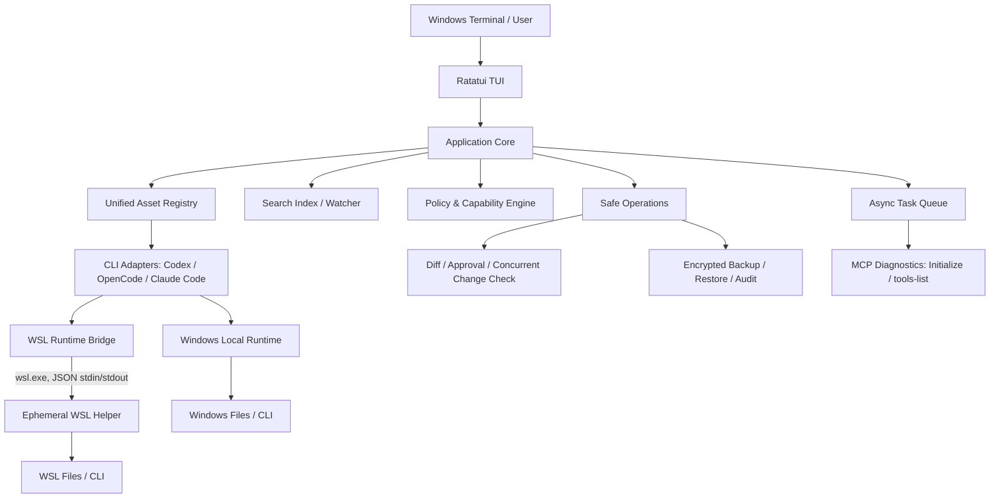

# AgentHub TUI — Codex CLI Implementation Handoff

> **Design Baseline:** v1.0 (최종 승인)
> **작성 기준일:** 2026-11-19 (Asia/Seoul)
> **설계 근거:** 사용자와 진행한 GrillMe Round 1–8, Q1–Q46 전체 결정
> **상태:** 설계 승인 완료 / **구현 미착수**
> **대상 독자:** Codex CLI에서 구현을 이어갈 개발자 또는 코딩 에이전트
> **언어:** 한국어 (코드·식별자는 영어 권장)

## 0. Codex CLI에게 전달할 우선 지시

이 문서는 **확정된 제품/아키텍처 요구사항**이다. 요구사항을 임의로 축소·확장하거나 변경하지 않는다.

1. **먼저 이 문서 전체와 현재 저장소 구조를 읽는다.** 사용자가 구현 시작을 명시적으로 지시한 뒤에만 파일을 생성하거나 수정한다.
2. 구현 전에 세 CLI(Codex, OpenCode, Claude Code)의 **현재 설치 버전과 공식 설정 스키마**를 확인한다. 버전/기능이 불분명하면 안전하게 **읽기 전용 / Unknown**으로 처리한다. 문서에 기술된 경로는 예시이며 실제 탐색 규칙은 Adapter별로 검증한다.
3. MVP는 **전 자산 탐색·검색·비교** + **MCP/Skill 관리** + **Skill 수동 변환** + **MCP 수동 진단** + **보안된 변경·복원**까지만 만든다. 나머지 5종 자산의 변경 기능을 임의로 구현하지 않는다.
4. 실제 사용자 CLI 설정 파일이나 비밀정보를 테스트용으로 덮어쓰지 않는다. 임시 디렉터리·fixture·테스트 전용 환경을 기본으로 한다.
5. 모든 변경은 **사전 검증 → Diff 미리보기 → 명시적 사용자 승인 → 암호화 백업 → 해시 재검사 → 적용 → 사후 검증 → 실패 시 롤백 시도**를 따른다. *백업 또는 사용자 승인이 없으면 쓰기를 하지 않는다.*
6. MCP 진단은 사용자가 명시적으로 요청한 경우에만 수행한다. `initialize`, `tools/list` 등 조회 단계까지만 수행하고 **임의의 `tools/call`은 자동 수행하지 않는다**.
7. Windows와 WSL에서 동일한 자산이 공유될 수 있으므로 **논리적 등록(Asset Registration)**과 **물리적 파일(Physical Resource)**을 분리한다.
8. 완료 선언은 문서 하단의 **AT-01~AT-10 Acceptance Test 모두 통과한 뒤**에만 허용한다. 미검증 기능은 검증된 것처럼 보고하지 않는다.

### Codex CLI 시작 프롬프트 예시

```text
현재 작업 디렉터리에서 agenthub_tui_codex_handoff_v1.0.md를 읽고,
지금 설치된 Codex/OpenCode/Claude Code의 기능과 설정 스키마를 검증한 뒤
구현을 위한 상세 작업 분해 및 위험 점검부터 수행해줘.
확정된 Q1~Q46 설계 결정과 MVP 범위는 변경하지 마.
사용자가 명시적으로 구현을 지시하기 전까지 실제 파일 변경을 하지 마.
구현 승인을 받으면 Windows 네이티브 Ratatui + 비상주 WSL Helper 구조를
작은 검증 단위로 구현하고 AT-01~AT-10의 통과 근거를 보고해줘.
```

---

## 1. 제품 개요 및 비목표

### 1.1 제품 정의

**AgentHub TUI**는 개인 개발자가 Windows 네이티브 터미널 하나에서 **Codex, OpenCode, Claude Code**의 확장 자산을 통합 탐색·검색·비교·관리·진단하는 **Rust/Ratatui 기반 Local AI CLI Asset Manager**이다.

- 사용자: 개인 개발자 1명 중심.
- 실행: Windows 네이티브 TUI 프로세스, 선택한 WSL 배포판 내부에 **필요할 때만 실행되는 Helper**.
- 탐색 대상: 현재 선택한 프로젝트 + 해당 환경 사용자 전역 설정. 프로젝트 다중 통합 뷰는 MVP 제외.
- 자산 7종: `MCP`, `Skill`, `Agent`, `Command`, `Instructions`, `Plugin`, `Hook`.
- 궁극적 제품: Manager. **MVP의 쓰기 지원은 MCP/Skill로 한정**.
- 핵심 차별점: 단순 파일 발견 이상의 **실제 적용 우선순위, 중복/충돌, 검증 신뢰도, 물리 파일 공유 관계**를 설명.

### 1.2 MVP 범위 — 반드시 구현

1. Windows와 선택한 WSL의 Codex/OpenCode/Claude Code 설치 여부·버전·자산 자동 탐색. 첫 실행 마법사로 환경/프로젝트 선택.
2. 7종 자산의 읽기 전용 통합 뷰, 검색(이름·설명·본문), CLI/유형/범위/환경 필터, 상세/원본/상태 보기.
3. CLI별 우선순위·적용 상태 해석. 중복 이름 그룹화·충돌 원인 표시. 불명확한 결과는 `Inferred` 또는 `Unknown`으로 표시.
4. MCP/Skill의 로컬 생성·수정·복제·삭제·수동 가져오기. Markdown 본문 편집은 외부 에디터 연계; 단순 설정은 TUI 폼.
5. Skill 폴더 전체의 **사용자 승인 기반** CLI 간 복사/규칙 기반 변환. 참조 파일/스크립트/심볼릭 링크/외부 경로와 충돌을 검사하고 미지원 필드는 경고.
6. 수동 MCP 진단: 연결 및 제한된 `tools/list` 조회, 취소·타임아웃·출력 제한·비밀정보 마스킹.
7. 파일 변경 감시 + 재탐색, 작업 큐와 진행 상태, 안전한 쓰기·Diff 승인·동시 수정 감지·암호화 백업·선택적 복원.
8. WSL 장애 또는 특정 CLI 오류에도 정상 환경은 계속 작동. 진단 로그는 로컬에만, 내보내기는 사용자 승인 후.
9. Windows 호스트 바이너리의 WSL Helper 번들, 사용자 승인 후 배포판에 설치, Helper 버전 호환 확인.
10. AT-01~AT-10 테스트 통과.

### 1.3 명시적 제외 — MVP에서는 구현하지 않음

- Agent, Command, Instructions, Plugin, Hook의 **생성/수정/삭제** (읽기·검색·비교는 포함).
- LLM Agent 실행·세션 관측·Subagent 제어·통합 챗 인터페이스.
- 자동 외부 카탈로그 수집, 원격 SSH 대상 관리, 여러 프로젝트를 동시에 합치는 대시보드.
- Skill 의존성 자동 설치/다운로드 및 복사 시 스크립트 자동 실행.
- MCP OAuth 로그인/토큰 저장소 재구현. 기존 CLI의 공식 인증 경로만 안내.
- WSL 상주 Daemon, 원격 텔레메트리, CLI 자동 업그레이드.
- 모든 과거 CLI 버전의 완전한 E2E 지원 또는 선행 대규모 성능 보증.
- 충돌 자동 병합·사용자 승인 없는 자동 수정.

---

## 2. 결정사항 추적표 — Q1~Q46 (모두 승인됨)

**Round 1 — 제품 기초**

| ID | 최종 결정 |
|---|---|
| Q1 | Viewer를 넘는 **Manager** 지향. 단 MVP 쓰기 범위는 Q34 우선. |
| Q2 | **현재 프로젝트 + 사용자 전역** 설정 탐색. |
| Q3 | 개인 개발자용. |
| Q4 | Windows + WSL 우선. |

**Round 2 — 탐색/관리 정책**

| ID | 최종 결정 |
|---|---|
| Q5 | Windows와 사용자가 선택한 WSL 배포판을 별도 환경으로 관리. |
| Q6 | MCP, Skill, Agent, Command, Instructions, Plugin, Hook 7종 탐색. |
| Q7 | 제품 목표는 추가·수정·복제·삭제·수동 가져오기. MVP는 Q34로 범위 제한. |
| Q8 | CLI 간 수동 복사·변환과 Diff/호환성 검토. 자동 동기화하지 않음. |
| Q9 | Diff 미리보기 → 승인 → 백업 → 적용, 복원 지원. |
| Q10 | 사용자 요청 시 MCP 연결 및 Tool 목록 진단. |

**Round 3 — 관측 및 UX**

| ID | 최종 결정 |
|---|---|
| Q11 | CLI별 규칙 기반 우선순위 해석 + 가능한 경우 실제 인식 검증. |
| Q12 | 동명 자산 그룹화, 실제 우선 적용 자산 및 충돌 근거 표시. |
| Q13 | 이름·설명·본문 검색과 CLI/유형/범위 필터. |
| Q14 | 파일 감시 + 수동 새로고침 + 누락 보완용 재탐색. |
| Q15 | 단순 설정은 TUI 폼, Markdown은 외부 편집기 + Diff 승인. |
| Q16 | Windows 네이티브 TUI, WSL 내부 탐색. |

**Round 4 — 모델 및 무결성**

| ID | 최종 결정 |
|---|---|
| Q17 | 환경·CLI·프로젝트·범위·원본 위치 기반 자산 식별. |
| Q18 | 공통 속성은 정규화, CLI 전용 Native Payload는 보존. |
| Q19 | 호환 항목에 대해서만 규칙 기반 변환, 미지원 항목은 경고·수동 보완. |
| Q20 | 사전 검증 → 승인 → 적용 → 사후 검증 → 실패 시 롤백 시도. |
| Q21 | 작업 단위 스냅샷/변경 이력/선택적 복원. |
| Q22 | 기본 마스킹·로그 비포함·환경변수 참조 우선·자격증명 복사 별도 승인. |

**Round 5 — TUI/작업 처리**

| ID | 최종 결정 |
|---|---|
| Q23 | 자산 종류 중심 탐색, CLI·환경 필터. |
| Q24 | Vim 및 일반 방향키, `/` 검색, `?` 도움말, 명령 팔레트. |
| Q25 | 개요/원본/Diff/상태 탭, 충분한 폭에서 분할 패널. |
| Q26 | 비동기 작업 큐, 진행 상태·취소·타임아웃·결과 로그. |
| Q27 | 명시적 승인 후 MCP 진단, 제한시간·출력 제한·취소·비밀정보 보호. |
| Q28 | 초기 스캔 + 메모리 검색 인덱스 + 변경 감지 및 재탐색. |

**Round 6 — 운영/테스트/릴리스**

| ID | 최종 결정 |
|---|---|
| Q29 | CLI 버전 자동 탐지, 기능별 Capability 판정, 알 수 없거나 미지원이면 안전하게 읽기 전용. |
| Q30 | `wsl.exe`로 필요 시 WSL Helper 실행, JSON Request/Response, 비상주. |
| Q31 | Read/Write/Managed 권한 및 적용 근거 표시, 조직 관리 정책 보호. |
| Q32 | 원본 해시로 외부 수정 충돌 감지, 무조건 덮어쓰기 금지. |
| Q33 | 단위/Fixture, 실제 CLI Smoke Test, Windows/WSL 통합 테스트. |
| Q34 | MVP는 **7종 전체 탐색 + MCP/Skill 관리 + Skill 변환 + 안전한 복원**. |

**Round 7 — 배포/장애/완료**

| ID | 최종 결정 |
|---|---|
| Q35 | Windows 바이너리에 Helper 번들, 사용자 승인 후 선택한 WSL에 설치. |
| Q36 | 첫 실행 마법사: CLI/환경/프로젝트 자동 탐지 후 사용자 선택. |
| Q37 | AgentHub 전용 버전 있는 설정 파일, 민감정보 제외 이식. |
| Q38 | 로컬 구조화 로그, 마스킹, 사용자 승인 진단 내보내기, 자동 원격 전송 없음. |
| Q39 | 환경 단위 장애 격리, 문제 환경 쓰기 중지·원인 표시·수동 재시도. |
| Q40 | 명시적 Acceptance Test 전체 통과 시 MVP 완료. |

**Round 8 — 동적 출처/보안의 최종 경계**

| ID | 최종 결정 |
|---|---|
| Q41 | 기본 경로 + 설정이 참조하는 로컬 경로 탐색. 외부 카탈로그는 참조/미검증 정보만. |
| Q42 | Found/Configured/Effective를 구분, `Verified`/`Inferred`/`Unknown` 신뢰도 표시. |
| Q43 | Skill 폴더 전체 복사, 파일 참조 검사, 임의 스크립트 자동 실행 금지. |
| Q44 | 논리 등록과 물리 파일 소유 구분, 공유 파일 변경/삭제 영향 범위 확인. |
| Q45 | 사용자별 암호화 백업, 보관 제한, 복원 가능성 검증. |
| Q46 | MCP OAuth 상태/기존 CLI 인증 방법 안내, AgentHub 직접 토큰 보관 금지. |

---

## 3. 시스템 아키텍처



### 3.1 설계 경계

- **UI:** 화면 렌더/입력에만 집중, 직접 설정 파일을 변경하지 않는다.
- **Core:** 통합 모델·상태 계산·정책·사용자 승인 상태·태스크 조정.
- **Adapter:** CLI별 경로 발견, 파서, 버전/Capability, 우선순위/상태 규칙, 변환 규칙; 원본 설정의 미지원 필드는 보존.
- **Runtime:** Windows 로컬과 WSL 내부 파일/프로세스 실행을 추상화. Helper는 비상주.
- **Operations:** 모든 변경·복원 작업의 검증/승인/동시성/백업/적용/검증/복구 수명주기를 단일화.
- **Diagnostics:** MCP의 표준 조회용 연결 상태 및 에러 추적; 비밀정보 취급 책임.

### 3.2 권장 Cargo Workspace (초기 설계, 조정 가능)

```text
agenthub/
├─ Cargo.toml                       # workspace
├─ README.md
├─ docs/
│  ├─ design-baseline.md            # 본 handoff의 승인 결정을 보존
│  ├─ capability-matrix.md          # 검증된 CLI 버전별 기능표
│  ├─ threat-model.md               # 민감정보/명령실행/경로 보안
│  └─ acceptance-tests.md           # AT-01~AT-10 실행 및 증거
├─ crates/
│  ├─ agenthub-core/                # registry, types, policy
│  ├─ agenthub-adapters/            # CLI별 adapter/serde/parsers
│  ├─ agenthub-runtime/             # Windows/WSL abstractions, JSON IPC
│  ├─ agenthub-operations/          # diff, backup, restore, concurrency
│  ├─ agenthub-diagnostics/         # MCP 검사
│  ├─ agenthub-tui/                 # Ratatui binary, view-model
│  └─ agenthub-wsl-helper/          # Linux one-shot binary
├─ fixtures/
│  ├─ codex/
│  ├─ opencode/
│  ├─ claude/
│  └─ shared-and-conflicts/
└─ tests/
   └─ integration/
```

**주의:** 이 파일 트리는 구현 시 제안 구조이며, 현재 생성된 저장소를 의미하지 않는다. 상위 모듈 간 import 순환을 만들지 않는다. Helper는 UI 코드를 링크하지 않는다.

### 3.3 Rust 기술 선택 (권고, 버전은 구현 시 확인)

- UI: `ratatui`, `crossterm`.
- 비동기: `tokio`, `tokio::process`, `tokio::sync::mpsc` 등.
- 직렬화/파싱: `serde`, `serde_json`, TOML/JSONC/YAML 처리용 보존형 또는 검증 가능한 파서.
- Diff: 라인 단위 차이 출력 및 자산 필드 단위 설명.
- 파일 감시: `notify`류 + 수동/주기적 보완 스캔 (WSL/Windows 경계 유의).
- 검색: 시작 시 메모리 인덱스 + fuzzy/name/content matching, 향후 필요 시 영구 인덱스.
- 로깅: `tracing`류, 민감정보 필터, 로컬 파일 회전/보관 제한.
- Windows 비밀 백업: DPAPI 등 사용자 컨텍스트의 OS 보호 기반. 권한·복구 시나리오 검증.

특정 크레이트/버전/CLI 명령을 사실로 고정하기 전에 공식 문서와 해당 설치 환경에서 검증할 것.

---

## 4. 통합 도메인 모델 및 상태 판정

### 4.1 추천 타입 개념

```text
EnvironmentId = WindowsHost | WslDistro { distro_name, helper_version }
Provider      = Codex | OpenCode | ClaudeCode
AssetKind     = Mcp | Skill | Agent | Command | Instructions | Plugin | Hook
AssetScope    = Global | Project | PluginProvided | Managed | Other
Confidence    = Verified | Inferred | Unknown
Permission    = Read | Write | Managed

AssetRegistration {
  asset_id, provider, environment_id, project_id?, scope,
  kind, logical_name, source_reference, physical_resource_id?,
  common_metadata, native_payload_ref,
  discovery_state, configured_state, effective_state,
  confidence, evidence[], permission, content_hash,
  compatibility_issues[]
}

PhysicalResource {
  resource_id, environment_id, canonical_or_resolved_path,
  kind_of_resource, identity_evidence, linked_asset_ids[],
  hash, symlink_info?, owner?, permissions?
}
```

- 자산 ID: **환경+CLI+프로젝트+범위+원본 위치**의 조합에 기반한 안정적 식별자. 같은 이름이라도 다른 CLI·범위이면 별개 등록.
- 내용 해시는 **식별자 대용이 아니라 변경 감지 및 동시성 검사**에 사용.
- 동일 물리 파일을 여러 등록이 참조할 때 삭제/변경 시 영향 범위를 명시하고 사용자 승인.
- `native_payload_ref`: 토큰 등이 포함될 수 있어 원본 값 전체를 UI Registry나 로그에 무조건 복제하지 않음. 민감 필드는 마스킹/불투명 참조.

### 4.2 상태 표시 규칙

- **Found:** 파일/설정 항목이 발견되었는지.
- **Configured:** 해당 CLI에 유효한 형태로 등록된 것으로 해석되는지.
- **Effective:** CLI 규칙상 실제 사용되는지; 검증이 불가능하면 Unknown/추정으로 둔다.
- **Verified:** 실제 CLI 또는 신뢰 가능한 상태 조회로 확인됨. *MCP 연결 성공과 자산 설정 반영 성공은 구분*.
- **Inferred:** Adapter 규칙과 로컬 파일로 추론된 결과.
- **Unknown:** 버전 불명·원격 출처 미조회·관리형 정책 접근 불가·검증 불가능.
- **Error/Conflict:** 파싱 오류, 권한 문제, 동일 이름 충돌, 경로 누락 등 구체 원인과 근거 포함.

항목을 발견하지 못했다고 *미설치 확정*으로 말하지 않으며, 검증 불가능한 상태를 `Verified`로 승격하지 않는다.

### 4.3 Adapter 계약 — 제안

```text
ProviderAdapter:
  detect_installation(environment) -> InstallInfo | NotFound | Unknown
  detect_version(environment) -> VersionInfo
  capabilities(version, environment) -> CapabilityMatrix
  discover_sources(context) -> [SourceDescriptor]
  parse(source) -> [NativeAsset] + diagnostics
  normalize(native_asset) -> AssetRegistration
  resolve_effective(registry, context) -> Resolution + evidence
  validate(asset, action) -> ValidationReport
  plan_operation(asset, action, target?) -> OperationPlan
  plan_skill_conversion(source, target_provider, target_env) -> ConversionPlan
```

- Adapter는 CLI별 설정 우선순위와 적용 규칙의 **근거**를 제공.
- 미지원 버전/필드는 **읽기 전용** 또는 명시적 미지원으로 다룸.
- TOML/JSONC/YAML/Markdown의 코멘트·순서·미지원 키를 보존할 수 없으면 해당 변경을 막거나 안전한 외부 편집기 + 전체 Diff 방식을 쓴다.
- 관리자 관리 설정은 강제 수정하지 않는다. OS 권한이 있다 해도 Policy가 편집 불가일 수 있다.

---

## 5. Windows / WSL Runtime 계약

### 5.1 토폴로지

- Windows에서 `agenthub.exe` 실행.
- 시작/설정 마법사에서 WSL 배포판 목록 탐지·선택.
- 사용자 승인 후 Windows 바이너리에 포함된 적절한 아키텍처의 Linux Helper를 선택한 배포판에 설치/검증.
- 요청 시에만 `wsl.exe --distribution <distro> --exec <helper_path>` 형태로 Helper 프로세스를 기동해 JSON 요청/응답을 송수신. **Shell 문자열 조합 금지**; 프로세스 인자는 별도 배열로 전달.
- `stdout`에는 프로토콜 응답만 기록, 진단 로그는 별도 마스킹 채널로. 상주 프로세스/Daemon 불필요.
- 버전/아키텍처·권한/설치 오류는 명시적으로 보고. 헬퍼 미존재/호환성 불일치면 WSL 작업을 중지하되 Windows 환경 사용은 유지.

### 5.2 메시지 개념 예시

```json
{
  "protocol_version": 1,
  "request_id": "uuid",
  "operation": "discover_assets",
  "payload": {
    "provider": "opencode",
    "project_root": "/home/user/work/my-project"
  }
}
```

```json
{
  "protocol_version": 1,
  "request_id": "uuid",
  "status": "ok",
  "data": { "assets": [] },
  "diagnostics": []
}
```

> 이 메시지는 **예시**이며 실제 스키마는 구현 계획에서 버전/오류 코드/스트리밍 방식 등을 정의. stdout을 구조화하고 자격 증명 또는 원본 토큰을 무분별하게 전달하지 않는다.

### 5.3 필수 보안

- 임의 셸 문자열 실행 금지, 절대 경로 확인, 경로 정규화, 심볼릭 링크 탈출 방지.
- Helper 바이너리 무결성·버전 검증, 사용자 승인된 배포판만 사용.
- Helper는 일반 사용자 권한으로 실행하고 불필요한 권한 상승 금지.
- 배포판별 독립 실패 처리, 취소/타임아웃 및 프로세스 종료 확인.
- Windows와 WSL의 동일 경로 문자열을 같은 파일로 오인하지 않음. 실제 파일 동일성은 환경/파일 시스템 확인에 기반.

---

## 6. TUI UX 계약

### 6.1 기본 레이아웃

```text
┌─ AgentHub ─ Workspace: current-project ─ Env: Windows / WSL Ubuntu ──┐
│ [All] [Codex] [OpenCode] [Claude]  / Search    [? Help]                │
├────────────────────────────┬──────────────────────────────────────────┤
│ EXPLORER                   │ DETAIL: code-review                      │
│ ▼ MCP (8)                  │ Overview | Source | Diff | Status         │
│   github                   │ Name, Type, Provider, Scope               │
│   filesystem               │ Found / Configured / Effective           │
│ ▶ Skills (12)              │ Confidence & Evidence                     │
│ ▶ Agents (5)               │ Linked physical resources                  │
│ ▶ Commands                 │ Warnings / Compatibility                   │
│ ▶ Instructions             │                                           │
│ ▶ Plugins                  │                                           │
│ ▶ Hooks                    │                                           │
├────────────────────────────┴──────────────────────────────────────────┤
│ j/k ↑↓ Navigate | Enter Detail | / Search | : Commands | ? Help | q  │
└────────────────────────────────────────────────────────────────────────┘
```

- 자산 종류 최상위, CLI·환경·범위·상태 필터.
- `j/k`, 방향키, Enter, Esc, `/`, `?`, 명령 팔레트; 단축키 충돌 시 화면 컨텍스트 기준.
- 화면 폭이 좁으면 상세 패널을 별도 뷰로 전환, 넓으면 분할 패널.
- 상세 탭: `Overview`, `Source`, `Diff`, `Status`; 원본 파일/설정 출처와 적용 근거 표시.
- MCP 진단은 명시적 버튼/키 액션에서 실행. 인증 상태, 연결 오류, Tool 목록만 표시.
- 변경 작업 상태: 미리보기, 승인 대기, 진행 중, 취소됨, 성공, 실패, 부분 복구 등 명확히 구분.

### 6.2 안전한 편집 UX

1. 자산 선택 → `Edit`, `Clone`, `Delete`, `Import`, `Convert` 중 가능한 작업만 활성화.
2. 읽기 전용/관리자 관리/버전 미지원 자산은 사유 표시, 편집 액션 비활성화.
3. 단순 필드는 폼; Markdown은 외부 편집기로 열고 수정 후 Diff 재검사.
4. 별도 작업 계획에서 대상 경로·영향 자산·민감정보 관련 경고·변환 제약 표시.
5. 사용자 승인 없이는 쓰지 않는다. 승인 직후에도 최신 해시 확인.

---

## 7. 변경 트랜잭션 / 백업 / 복원

### 7.1 단일 작업 수명주기

```text
Collect Intent
  -> Validate Permissions & Capabilities
  -> Resolve Physical Resource Impact
  -> Build OperationPlan
  -> Preview Diff (secrets masked)
  -> Explicit User Approval
  -> Create Protected Pre-Change Snapshot
  -> Recheck Source Hash & Environment State
  -> Apply Changes (per-resource serialized)
  -> Reparse / Revalidate / Confirm Effective Status if possible
  -> Success Audit OR Rollback Attempt + Partial Failure Audit
```

- **쓰기 전 승인과 백업이 선행 조건**이다.
- 하나의 물리 파일에 대한 동시 쓰기는 직렬화.
- 저장 직전 원본 해시가 달라지면 **중지 → 충돌 Diff → 재승인**. 사용자가 승인한 내용을 조용히 덮어쓰지 않음.
- 파일 교체는 가능한 경우 임시 파일 + flush + 원자 rename 등 안전한 방식을 사용. 파일 시스템 차이와 ACL을 확인.
- Windows↔WSL 복합 변경은 분산 원자 트랜잭션이 아님. 실패 시 베스트에포트 롤백, 성공/실패 항목 보고.
- 설정 파일에 기밀이 포함되면 **백업 전체를 사용자별 OS 보호 방식으로 암호화**. 보관 개수/기간 제한 및 복원 테스트 필요.
- 인증정보는 로그·진단 내보내기·기본 Diff에 노출 금지. 자격 증명 복사는 별도 사용자 승인.
- 원본 파일을 복원할 경우에도 현재 해시/외부 변경 여부를 확인하여 신규 변경을 임의로 제거하지 않음.

### 7.2 Skill 변환 계약

- **폴더 전체** 복사 (`SKILL.md` 외 스크립트/참조/자산 등 포함), 디렉터리 구조와 내부 상대 참조 검증.
- 파일명/ID/메타데이터와 CLI별 Skill 로딩 규칙 검사.
- 외부 절대 경로, Symlink, 실행 권한, 원격 의존성, 충돌 대상은 별도 경고 또는 승인.
- 지원 가능한 구조만 규칙으로 변환. 미지원 의미/권한/명령은 임의 해석하지 않고 경고.
- 복사 완료 후 대상 CLI의 실제 인식 여부 확인을 시도; 불가하면 `Inferred`/`Unknown`.
- 복사 중 **스크립트나 의존성 설치 명령을 자동 실행하지 않음**.

### 7.3 MCP CRUD와 인증

- MCP 설정 변경은 CLI별 실제 스키마의 읽기/쓰기를 따르며, 미지원/관리형 설정은 쓰기 금지.
- 인증값이 필요한 경우 기존 CLI의 공식 인증 흐름 안내. AgentHub 자체 OAuth/토큰 저장소를 만들지 않음.
- `Configured`와 `Connected`는 별도 상태. 연결 검사는 사용자가 명시적으로 요청한 경우만.
- `initialize`/`tools/list` 결과는 제한된 시간·출력 크기 안에서 표시; 조회 중 원격/로컬 서버가 기동될 수 있음을 사용자에게 알림.

---

## 8. 보안 및 실패 모드

| 위협/실패 | 필요한 동작 |
|---|---|
| 토큰 포함 설정/로그 | 기본 마스킹, 구조화 로그 필터, 진단 내보내기 리뷰 |
| 백업 파일 탈취 | 사용자별 OS 보호 암호화, 파일 접근권한 제한, 보관 정책 |
| 공유 Skill 실수 삭제 | 물리 파일 참조자 목록 표시, 영향 범위 승인, 삭제 전 백업 |
| 외부 프로그램 동시 수정 | 해시 충돌 감지 및 재검토·재승인 |
| 버전 미확인 CLI | 읽기 전용 + Unknown 및 근거 표기 |
| 관리형 설정/정책 | Read/Write/Managed 구분, 편집 불가 사유 제시 |
| 외부 원격 Skill 소스 | 참조 정보/미검증으로 표시, 자동 원격 수집 금지 |
| 악성 Skill/스크립트 | 복사 시 실행 금지, 링크/경로 탈출 검사 |
| MCP 서버 악성 출력 | 크기·시간 제한, 스트림 분리, 자격증명 필터 |
| WSL Helper 실패 | WSL 환경만 비활성화, Windows 정상 동작, 수동 재시도 |
| 부분 적용 후 롤백 실패 | 성공/실패 자원별 상세 기록, 복구 가이드, 성공으로 표시 금지 |
| 파일 감시 누락 | 수동 새로고침 및 재탐색으로 보완 |

---

## 9. 테스트 전략 및 MVP Acceptance Tests

### 9.1 테스트 레이어

- **Unit:** 파서/정규화/동명 충돌/우선순위/권한/Capability/검증 신뢰도.
- **Fixtures:** 세 CLI의 공개 샘플과 테스트용 파일; 전역/프로젝트/관리형/공유 파일/충돌/심볼릭 링크/미지원 필드 포함.
- **Integration:** 실제 설치된 CLI에 대한 무해한 Smoke Test, WSL Helper 왕복, Windows/WSL 경로 분리, 취소·타임아웃.
- **Security/Recovery:** 민감정보 마스킹, 암호화 백업·복원, 해시 충돌, 부분 롤백 실패, 백업 무결성.
- **E2E:** TUI 기본 탐색·검색·Diff 승인·CRUD·변환 워크플로.
- 검증 시 실제 개인 설정 파일은 읽기 위주로만 접근. 쓰기 테스트는 fixture/격리 프로젝트에 한정.

### 9.2 필수 합격 조건 (Q40)

| ID | 필수 시나리오 | 통과 기준 / 증거 |
|---|---|---|
| **AT-01** | 3개 CLI와 7종 자산 탐색 | 지원 버전/Fixture에서 발견, 환경·범위·원본 경로 식별. 일부 불가 자산은 근거 있는 Unknown. |
| **AT-02** | 적용 상태/충돌 분석 | Found/Configured/Effective 구분, 같은 이름 우선순위·근거·Confidence 정확. |
| **AT-03** | 검색 및 변경 감지 | 이름/설명/본문 검색, 필터, 외부 변경 후 인덱스 갱신 및 재탐색. |
| **AT-04** | MCP/Skill CRUD | 테스트 환경에서 생성/수정/복제/삭제/수동 가져오기와 재파싱 성공. |
| **AT-05** | CLI 간 Skill 변환 | Skill 전체 복사, 호환성 경고, 사용자 승인, 미지원 경로/스크립트 자동 실행 없음. |
| **AT-06** | MCP 진단 | 사용자 명시 실행, 초기화·Tool 목록, 실패/취소/타임아웃/출력 제한 검증. |
| **AT-07** | 안전한 수정·복원 | 승인 전 쓰기 없음, 원본 해시 충돌 차단, 암호화 백업·정상 복원, 부분 복구 보고. |
| **AT-08** | 환경별 장애 격리 | WSL/개별 CLI 실패해도 나머지 환경 탐색 가능, 실패 대상 쓰기 차단. |
| **AT-09** | 민감정보 비노출 | 화면, 로그, 기본 Diff, 진단 내보내기에 토큰/비밀번호 누출 없음. |
| **AT-10** | 실제 실행 통합 | 지정된 지원 CLI에서 Smoke Test, `wsl.exe`↔Helper 프로토콜, 초기 실행 마법사 검증. |

**완료 규칙:** AT-01~AT-10 모두 통과해야 MVP 완료. 미실행·미검증 테스트는 통과로 기록하지 않는다. 결과에는 실행 OS/WSL 배포판·CLI 버전·테스트 명령·결과·근거 링크/로그 위치(비밀 제외)를 포함.

---

## 10. 단계별 구현 계획 (Codex CLI용 제안)

### Phase 0 — 기준선과 호환성 검증

- 본 문서를 저장소 설계 기준선으로 등록.
- 설치된 Codex/OpenCode/Claude Code 버전, 설정 경로, 7종 자산 지원 방식, 관리형 정책, 해당 버전의 공개 CLI 확인 명령 정리.
- `capability-matrix.md` 및 fixture/테스트 대상 준비. **모호한 기능을 추정 구현하지 않음**.
- 최초 사용자 프로젝트 설정에는 변경을 가하지 않음.

### Phase 1 — Read-only Discovery MVP

- 공통 Domain Type, Provider Adapter 인터페이스, Windows/WSL Runtime 인터페이스.
- `detect`/`discover`/`parse`/`normalize` 구현, 원본 경로/출처/상태 추적.
- Windows TUI 기본 자산 트리·상세·검색·필터. 파일 감시·재탐색.
- 실제 상태 증거와 Unknown 표시. Q11/Q12/Q42 검증.

### Phase 2 — Windows↔WSL Helper

- JSON IPC 프로토콜 설계·버전 협상, WSL 배포판 선택, Helper 배포·무결성 검증, 비상주 실행.
- 요청/응답 경계에서 cancellation/timeout/path/permissions 테스트.
- Host·WSL 별도 탐색 결과를 Registry에 통합.

### Phase 3 — Safe Operations 기반

- 계획/검증/Diff/승인/해시 충돌/백업/적용/검증/롤백.
- 보호된 백업 저장소 및 복원 테스트 먼저 구현한 뒤 쓰기 기능 활성화.
- 공유 자산 영향 분석, 관리형 정책 쓰기 차단, 설정 코멘트/미지원 필드 보존 정책 검증.

### Phase 4 — MCP/Skill Management

- MCP/Skill CRUD 및 수동 Import.
- Markdown 외부 편집기와 Diff 검토 연결.
- Skill 폴더 전체 복사·규칙 기반 변환·호환성 경고·사용자 승인 및 복원.
- MCP 수동 진단과 Tool 목록 조회, 표준 인증 안내.

### Phase 5 — Hardening & Release

- First-run wizard, 패키징/Helper 번들, 로컬 진단 내보내기, 부분 장애 UX.
- Windows/WSL 통합 및 보안 회귀 테스트.
- AT-01~AT-10 개별 증거 수집 후 MVP 완료 여부 판정.

**각 Phase의 원칙:** 테스트 통과/설명 가능한 상태 판정 없이 다음 단계의 위험한 쓰기 기능을 먼저 열지 않는다.

---

## 11. 구현 전 확인할 사실 및 가정

다음은 **결정할 제품 정책이 아니라 환경에서 검증해야 할 사실**이다. 사용자가 확인 가능한 정보를 이미 제공했다면 중복 질문하지 않는다.

1. 실제 설치된 세 CLI의 버전, 실행 위치(Windows/WSL/양쪽), 기본·전역·프로젝트 경로, 호환 설정 포맷.
2. Windows와 선택한 WSL 배포판의 아키텍처(x86_64/arm64), Helper 실행 가능 포맷 및 설치 권한.
3. 각 CLI의 7종 자산에서 실제 지원되는 경로·우선순위·CLI 확인 기능.
4. TOML/JSON(C)/YAML/Markdown 변경 시 **미지원 필드/주석 보존** 가능한 파서·쓰기 방식.
5. DPAPI 등을 이용한 백업 암호화/복원/키 수명주기 및 WSL 경계 위협 모델.
6. MCP 서버 transport(stdio/HTTP 등), 표준 초기화·조회·타임아웃/취소 방식.
7. 실행 시 외부 에디터 환경 설정, 편집된 파일 되돌리기, 사용자 확인 UX.
8. 실제 성능을 측정한 뒤 필요한 경우에만 지속 인덱스/캐시를 도입.

**호환성 원칙:** 공식 자료와 실제 설치 상태가 일치하지 않으면 사용자의 자산을 변경하지 않고 미지원/Unknown으로 표시하고 근거를 기록한다.

---

## 12. 작업 결과 보고 템플릿

Codex CLI는 구현 작업을 수행한 뒤 다음 형식으로 보고한다.

```markdown
## AgentHub Implementation Report
- Baseline: Design v1.0 / Q1–Q46 유지 여부
- 구현 Phase 및 변경한 파일 목록
- CLI 버전/OS/WSL 배포판 검증 결과
- 구현 기능 및 미구현 기능(MVP 범위 기준)
- AT-01~AT-10 결과(Pass / Fail / Not Run)와 근거
- 보안 검증: 백업/로그/민감정보/롤백
- 알려진 제약, 미해결 위험 및 다음 단계
```

**문서 마지막 상태:** 설계 확정. 사용자가 별도로 구현을 지시하기 전까지 프로젝트 코드/설정/파일 생성은 금지. 이 Markdown handoff 파일 자체만 현재 전달 대상.
